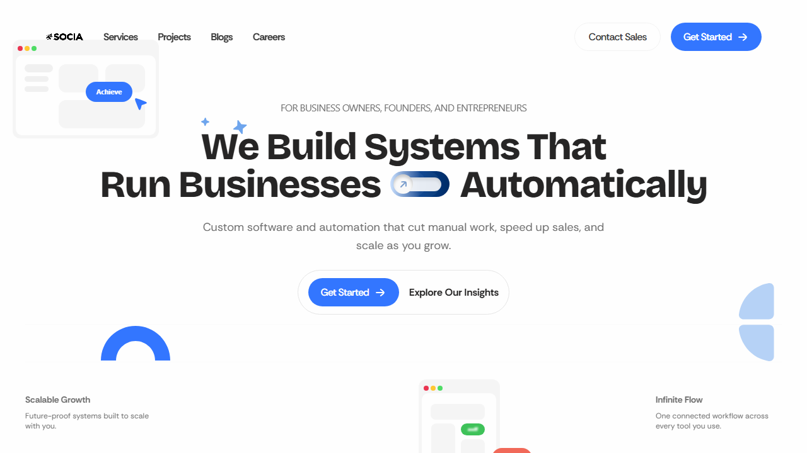

# BUG-001 — Page title does not match expected value

## Details

| Field | Value |
|-------|-------|
| Bug ID | BUG-001 |
| Title | Page title does not match expected value |
| Related test case | TC-002 |
| Severity | Low |
| Environment | Desktop Chrome (Playwright Chromium 1.64.1), Windows, https://socia.ph/ |
| Reported by | Kiro |
| Date | 2026-10-27 |

## Steps to reproduce

1. Open https://socia.ph/ in a browser.
2. Look at the browser tab title.

## Expected result

The tab should show:

> **Socia | Custom Business Systems & Automation**

## Actual result

The tab shows:

> **Welcome to Socia**

The title is shorter than expected and omits the tagline "Custom Business Systems & Automation", which is used in SEO and branding.

## Screenshot

_Take a screenshot of the browser tab showing "Welcome to Socia" and save it as `screenshots/BUG-001.png`._
