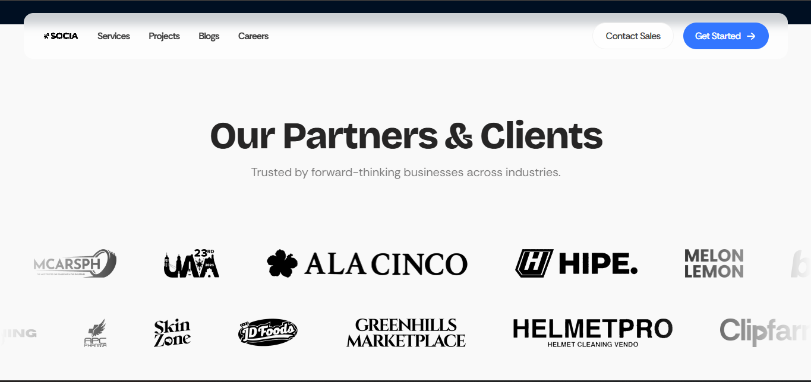

# BUG-002 — Partner logo images fail to load on homepage carousel

## Details

| Field | Value |
|-------|-------|
| Bug ID | BUG-002 |
| Title | Partner logo images fail to load on homepage carousel |
| Related test case | TC-009 |
| Severity | Medium |
| Environment | Desktop Chrome (Playwright Chromium 1.64.1), Windows, https://socia.ph/ |
| Reported by | Kiro |
| Date | 2026-10-27 |

## Steps to reproduce

1. Open https://socia.ph/.
2. Scroll down to the partner logos / clients carousel section.
3. Observe the images.

## Expected result

All partner logo images load and are visible. No broken image icons are shown.

## Actual result

20 unique image URLs return no pixel data (`naturalWidth === 0`). They appear as broken image icons in the browser. Because the carousel repeats its slides, the same broken images appear many times across the page DOM.

**Unique broken image URLs (37 total):**

| # | URL |
|---|-----|
| 1 | https://socia.ph/images/partnersSVG/MCars%201.webp |
| 2 | https://socia.ph/images/partnerColored/MCarsPH%201.webp |
| 3 | https://socia.ph/images/partnersSVG/UAA%201.webp |
| 4 | https://socia.ph/images/partnersSVG/Ala%20Cino%201.webp |
| 5 | https://socia.ph/images/partnerColored/alacinco%20colored%201.webp |
| 6 | https://socia.ph/images/partnersSVG/Hipe%201.webp |
| 7 | https://socia.ph/images/partnersSVG/Melon%20Lemon%201.webp |
| 8 | https://socia.ph/images/partnerColored/melonlemon%201.webp |
| 9 | https://socia.ph/images/partnersSVG/Behind%20The%20Work%201.webp |
| 10 | https://socia.ph/images/partnerColored/BehindTheWrk%201.webp |
| 11 | https://socia.ph/images/partnersSVG/SOCIA%20CRM%201.webp |
| 12 | https://socia.ph/images/partnersSVG/Saria%201.webp |
| 13 | https://socia.ph/images/partnerColored/saria%201.webp |
| 14 | https://socia.ph/images/partnersSVG/Pet%20Shop%20Ni%20Roy%201.webp |
| 15 | https://socia.ph/images/partnerColored/petshopniroy%201.webp |
| 16 | https://socia.ph/images/partnersSVG/Edens%20Pastillas%201.webp |
| 17 | https://socia.ph/images/partnerColored/edens%201.webp |
| 18 | https://socia.ph/images/partnersSVG/APC%20Pharma%201.webp |
| 19 | https://socia.ph/images/partnerColored/apc%20pharma%201.webp |
| 20 | https://socia.ph/images/partnersSVG/Skin%20Zone%201.webp |
| 21 | https://socia.ph/images/partnerColored/skinzone%201.webp |
| 22 | https://socia.ph/images/partnersSVG/JD%20Foods%201.webp |
| 23 | https://socia.ph/images/partnerColored/jdfoods%20color%201.webp |
| 24 | https://socia.ph/images/partnersSVG/Greenhills%20Marketplace%201.webp |
| 25 | https://socia.ph/images/partnerColored/greenhills%20marketplace%201.webp |
| 26 | https://socia.ph/images/partnersSVG/HelmetPro%201.webp |
| 27 | https://socia.ph/images/partnerColored/helmetpro%201.webp |
| 28 | https://socia.ph/images/partnersSVG/Clipfarm%201.webp |
| 29 | https://socia.ph/images/partnerColored/Clipfarm_White@4x-8%201.webp |
| 30 | https://socia.ph/images/partnersSVG/Tambay%201.webp |
| 31 | https://socia.ph/images/partnerColored/tambay%201.webp |
| 32 | https://socia.ph/images/partnersSVG/KCO%201.webp |
| 33 | https://socia.ph/images/partnerColored/kco%201.webp |
| 34 | https://socia.ph/images/partnersSVG/RZ%20Ecommerce%201.webp |
| 35 | https://socia.ph/images/partnerColored/rzcommercelogo%201.webp |
| 36 | https://socia.ph/images/partnersSVG/Learning%20Dock%201.webp |
| 37 | https://socia.ph/images/partnerColored/Learning%20Dock%202.webp |

**Note:** The URL pattern suggests the files exist in a `/partnersSVG/` and `/partnerColored/` path. Likely cause: assets were not uploaded to the server, or file names contain URL-encoded spaces that do not match the actual filenames on disk.

## Screenshot

_Take a screenshot of the broken image icons in the carousel and save it as `screenshots/BUG-002.png`._
